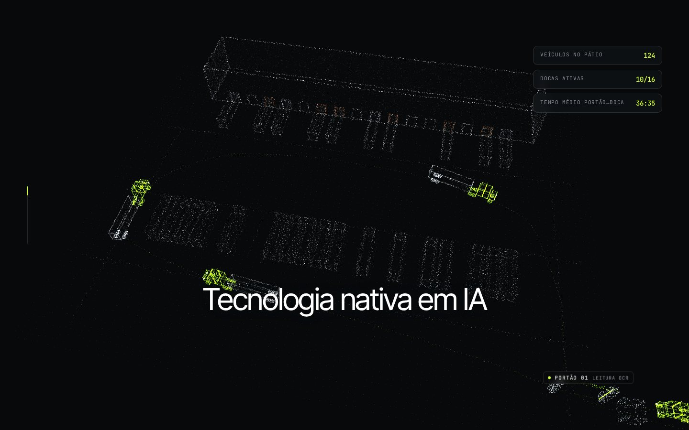
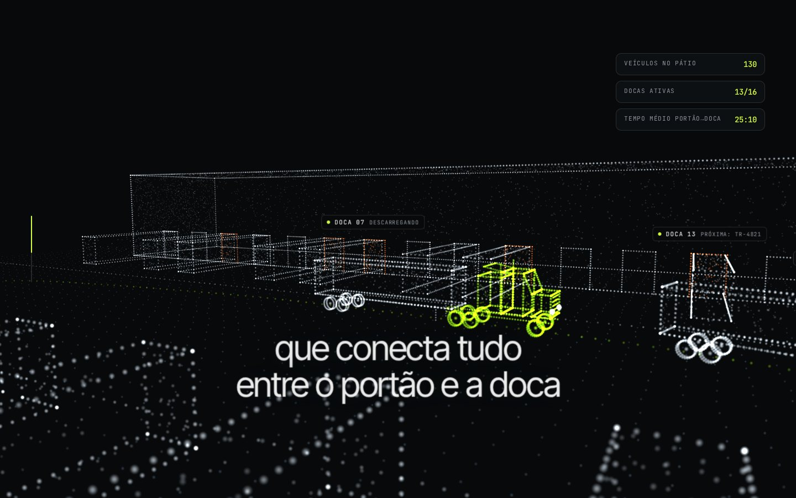
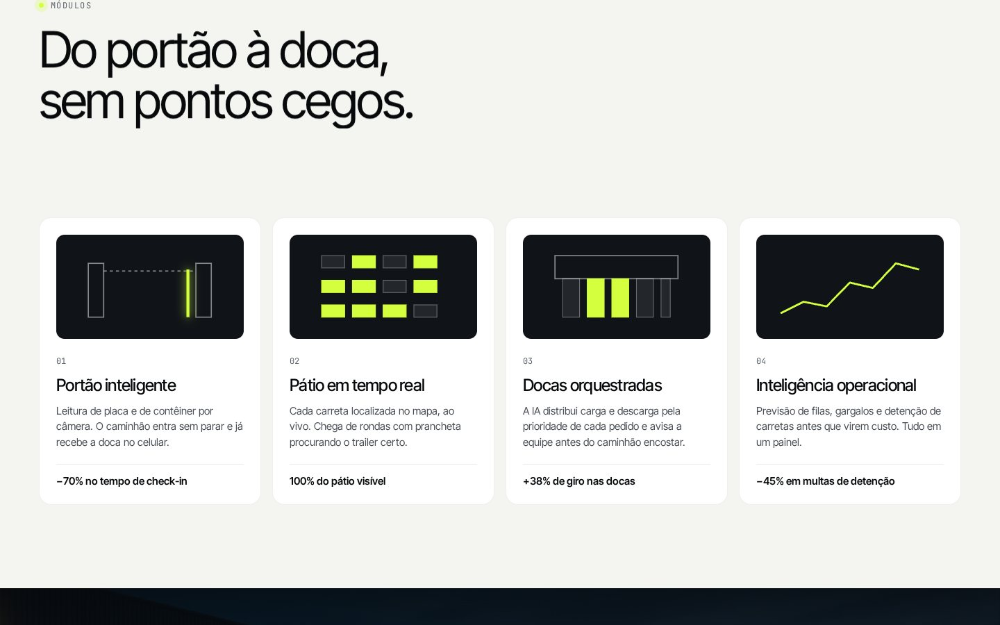
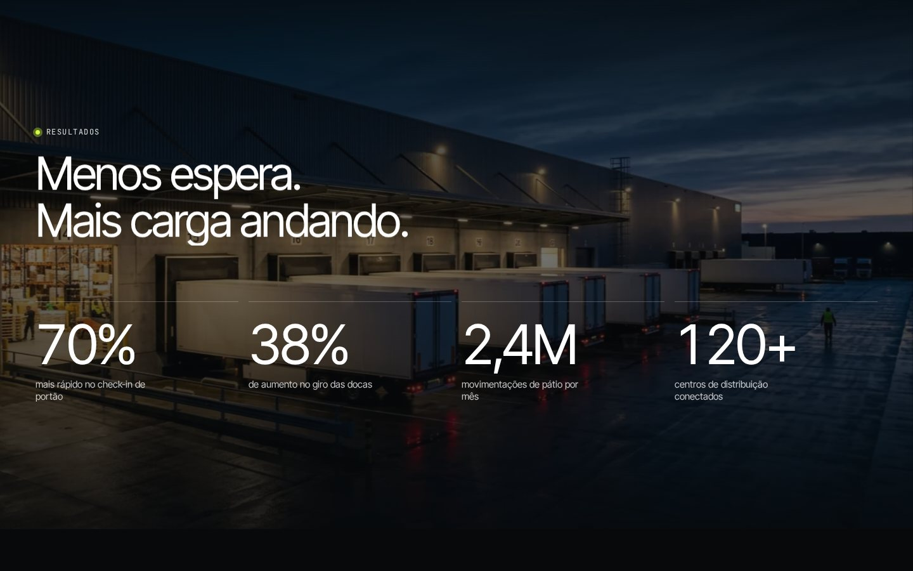
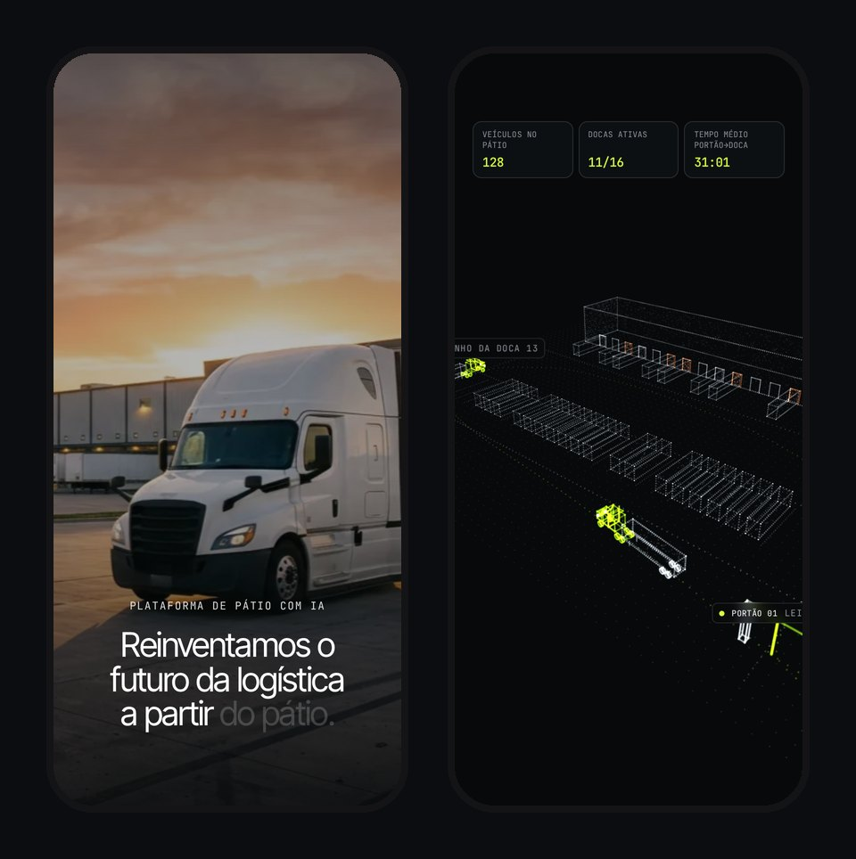

<div align="center">

# Doca

**Landing page de uma plataforma fictícia de gestão de pátios logísticos.**<br/>
Hero cinematográfico e um pátio em 3D feito de pontos, com a câmera guiada pelo scroll.

[**Ver o site no ar →**](https://doca-patio.netlify.app)


</div>

## Sobre o projeto

A Doca é uma empresa inventada para este estudo: uma plataforma com IA que acompanha cada caminhão do portão até a doca. A ideia foi contar o produto em uma única rolagem: a foto real do pátio vira um modelo 3D, a câmera desce até o nível das docas e os números aparecem no momento certo.

Tudo é feito à mão, sem template: layout, animações, a cena 3D e os ícones dos módulos.

## Destaques

| | |
|---|---|
|  |  |
| **Pátio 3D em nuvem de pontos.** Galpão, docas, carretas e caminhões são desenhados ponto a ponto em Three.js. Os pontos se montam quando a seção aparece. | **Câmera guiada pelo scroll.** A câmera voa do alto até o nível das docas. As etiquetas acompanham os objetos e o painel atualiza veículos, docas e tempo. |
|  |  |
| **Módulos com mini-animações.** Leitura no portão, pátio ao vivo, docas e gráfico, cada um com sua animação. | **Resultados.** Números que contam ao entrar na tela, sobre a foto das docas com parallax. |

### No celular



No celular, a cena 3D fica mais leve: tem menos pontos e resolução limitada. A foto do hero também tem um corte próprio para a tela vertical.

## Como funciona

- **Hero.** Ao rolar, a frase "Reinventamos o futuro da logística a partir do pátio." acende palavra por palavra. A foto aproxima e escurece para emendar com a cena 3D.
- **Cena 3D** (`src/yard.js`). Uma classe `Cloud` gera pontos ao longo das arestas e das faces de caixas e linhas. Um shader próprio controla tamanho, cor e brilho de cada ponto. O progresso do ScrollTrigger move a câmera por um caminho e troca os textos em três etapas.
- **Clientes.** Duas faixas de logos fictícios andam em sentidos opostos e aceleram com a velocidade do scroll.
- **Interface.** O menu muda de cor nas seções claras e se esconde ao rolar para baixo.
- **Acessibilidade e desempenho.** O site respeita `prefers-reduced-motion` e, sem WebGL, mostra uma foto no lugar do 3D. A renderização pausa quando a cena sai da tela.

## Estrutura

```
├── index.html        # marcação de todas as seções
├── src/
│   ├── main.js       # scroll (Lenis + ScrollTrigger), textos, contadores, menu
│   ├── yard.js       # pátio 3D em nuvem de pontos (Three.js + shader)
│   └── style.css
├── public/img/       # fotos do hero e das docas (desktop e celular)
├── docs/             # imagens deste README
└── netlify.toml
```

## Rodar localmente

```bash
npm install
npm run dev       # servidor de desenvolvimento
npm run build     # gera a versão de produção em dist/
```

## Créditos

Design, desenvolvimento e animações: **Giselly Pereira**.<br/>
Fotos geradas com IA. A Doca, os clientes e os números são fictícios.
